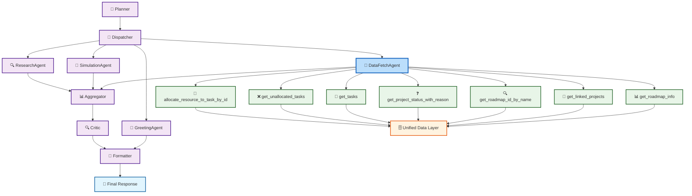

# Enhanced LangChain Agent Architecture

## Enhanced Architecture Benefits

### Streamlined Agent Structure
- **Unified DataFetchAgent**: Consolidates both roadmap and project data retrieval functions into a single, specialized agent
- **Reduced Context Switching**: Eliminates the need to route between multiple data agents
- **Simplified Decision Logic**: Dispatcher needs fewer routing rules
- **Faster Processing**: Single agent handles all data retrieval operations

### Optimized Data Layer
- **Unified Data Access**: All tools connect to a consolidated data layer
- **Improved Caching**: Single agent can implement shared caching strategies
- **Consistent Error Handling**: Standardized approach across all data operations

### Tool Integration
- **Tool Reuse**: All data retrieval tools available to a single agent
- **Context Preservation**: Agent maintains context across different data queries
- **Parallel Processing**: Can batch similar data requests together

## Component Descriptions

### Agents
- **Planner**: Creates execution plans based on user queries
- **Dispatcher**: Routes tasks to specialized agents
- **DataFetchAgent**: Unified agent handling all data retrieval operations (roadmap and project data)
- **SimulationAgent**: Runs simulations and predictions
- **ResearchAgent**: Gathers information and research
- **GreetingAgent**: Handles simple user greetings
- **Aggregator**: Combines results from multiple agents
- **Critic**: Evaluates response quality
- **Formatter**: Performs final text formatting and delivers the response to user

### Tools
- **get_roadmap_info**: Retrieves basic information about a roadmap
- **get_linked_projects**: Gets projects linked to a roadmap
- **get_roadmap_id_by_name**: Finds roadmap ID from name
- **get_project_status_with_reason**: Gets project status with explanation
- **get_tasks**: Returns list of tasks for a project
- **get_unallocated_tasks**: Lists tasks with missing resources
- **allocate_resource_to_task_by_id**: Assigns resources to tasks 
